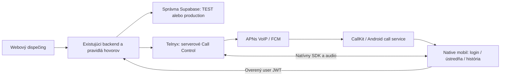

# Jednoduchý mobilný dispečing: stratégia a prvé vydanie

Stav auditu: **2026-10-11**. Majiteľ oznámil nasadenie novej produkčnej verzie
a následne vybral „Plán aj prvý základ v kóde“. Cieľ je natívna aplikácia pre
iPhone a Android s existujúcim prihlásením, ústredňou a telefonovaním.

## Overené východisko

| Oblasť | Overenie pred implementáciou |
| --- | --- |
| Produkcia | `1830bbebfb26096a52785d1fd775d3e745665dc4`; canonical live/ready 200; deployment `dpl_3BrzFASPozuuEGMBao7P7NcofwD3` |
| Stabilný TEST | `f338a4a1101bac18c3c96cba5cab5e5b7a118eb5`; canonical live/ready 200; deployment `dpl_2DvC8gqihjs4drvsc9sGxQJu6gQk` |
| Obsah | `main` a `dev` mali rovnaký git tree; release code `c7bf94e6fe46` |
| Prihlásenie | Supabase Auth, **e-mail a heslo**; organizačný profil a rola |
| Telefonovanie | Telnyx WebRTC na webe, serverové Call Control, routing, prezencia, história, mobile device namespace |
| Schéma | V oboch vlastných databázach read-only potvrdené mobile devices, applicationDevice ring offers, mobile call preference a history search RPC |
| Alfo | `Alfopure/alfo`, čítaný main `696209287937485b0ae3b61e277dea04522c7edd`; Expo 57/RN 0.86, secure login a postupné moduly; natívny voice/push stále ďalšia fáza |

Z Alfo preberáme spôsob oddelenia mobilu, auth a build varianty. Jeho
databáza, session-context protokol, Expo project ID a credentials sa nepreberajú.
Health dokazuje nasadenie aplikácie, nie úspešný hovor alebo push.

## Rozsah mobilnej verzie 1

Tri záložky: **Ústredňa — História — Účet**. Pred nimi obyčajné prihlásenie
e-mailom a heslom. Zabudnuté heslo otvorí existujúcu obnovu na správnom webe.
Operátor používa svoj aktuálny účet a serverové oprávnenia.

Ústredňa vo výslednom telefonujúcom vydaní ponúkne stav Dostupný/Pauza,
telefónne číslo a Zavolať. Pri hovore zobrazí volajúceho, Prijať/Odmietnuť
a po spojení Ukončiť, stíšenie mikrofónu, audio výstup a DTMF. Rozlíši
vytáčanie, zvonenie, pripájanie audia a skutočne spojený hovor.

História použije existujúce výsledky hovorov, filtre Všetky/Zmeškané/Prijaté/
Odchádzajúce, vyhľadávanie a ďalšie stránky. Z čísla možno pripraviť spätné
volanie; hovor začne až po výslovnom stlačení Zavolať. Účet zobrazí vlastnú
identitu, prostredie a odhlásenie.

Prvé vydanie nepotrebuje prípady, mapy, SMS, chat, konfiguráciu ústredne,
manažérsky dozor ani archív nahrávok. Ďalšie agendy sa pridajú po stabilnom
príjme a odchádzajúcom telefonovaní.

## Poradie realizácie

| Míľnik | Výsledok | Podmienka prijatia |
| --- | --- | --- |
| **M1 — základ, tento rozsah** | samostatný mobil, prihlásenie, read-only ústredňa, autorizovaná história, účet; backend API v1 | kontroly zdroja/DTO/auth, JS balíky oboch platforiem, TEST deployment; osobitne fyzický login a čítanie |
| **M2 — natívny telefón** | proof build Telnyx SDK, mikrofón/audio session, systémový call UI, tokenové prihlásenie | podpísaný iPhone a Android build, skutočný prijatý a odchádzajúci hovor s obojstranným audiom |
| **M3 — zvonenie spiaceho mobilu** | APNs VoIP/PushKit/CallKit a FCM/Android call integration; registrácia/revokácia zariadenia | web zavolá kolegovi a zamknutý mobil po nečinnosti reálne zvoní; expirovaná/zrušená ponuka sa neprijme |
| **M4 — bežná služba** | natívny endpoint v ring pláne, pauza/obsadenosť, jeden víťaz, fallback, caller ID a história | príjem zo zákazníckej linky a volanie z mobilu pri bežnej službe; web a mobil majú zhodný stav |
| **M5 — pilot a release** | identifikovaný TEST mobile build + backend commit; až potom schválený production rozsah | fyzické skúšky nižšie, odovzdanie majiteľovi, jeho explicitné schválenie; App Store/Play neskôr |

Po M1 je priorita **M2/M3**, nie pridávanie ďalších obrazoviek. Tlačidlo
Zavolať v M1 zostáva neaktívne a rozhranie to vysvetľuje. Žiadne úspešné
čítanie, mock ani JS export sa neoznačuje ako funkčné telefonovanie.

## Architektúra a rozhodnutia pred M2/M3

**Server riadi hovory.** Mobilné vytáčanie musí ísť cez existujúci
`startOutboundCall`: overenie čísla/linky, caller ID, kill switch, limit
a idempotentný request ID. Najprv vznikne operátorská vetva; automaticky
prijať možno iba presnú vlastnú vetvu z výslovného odchádzajúceho pokusu.
Priame SDK vytáčanie externého čísla by tento tok obišlo.

**Rovnaký actor, nový transport.** M1 má výhradne overené Bearer user JWT
a serverový lookup aktívneho ľudského profilu. Existujúce cookie/CSRF routy
sa nemenia. Mutujúce mobilné routy sa pridajú až spolu s natívnym telefónom
a znovu použijú rovnaké serverové call-actions a kontroly vlastníctva.
Každé prijatie/odmietnutie/ukončenie sa viaže na presnú ponuku, session,
device lease a prostredie; teleso requestu nevyberá actor-a.

**Spiaci mobil potrebuje vlastnú dostupnosť.** Dnešná živá registrácia
s heartbeat do 120 s nemôže rozhodovať o prebudení natívneho zariadenia.
Oddeliť pripojený SIP endpoint od zariadenia oprávneného dostať VoIP push.
Platný push token nie je dôkaz doručenia. Ponuka ostáva krátka, s aktuálnym
ownerom a existujúcim timeout/fallbackom. Nerobiť nekonečný background socket,
falošný heartbeat ani nový worker/listener/cron.

**Web → kolega dnes vyberá webové zariadenie.** Rozšíriť
`resolveColleagueTarget` na natívny mobile endpoint a zachovať obsadenosť,
pravidlá interného volania počas pauzy a pravidlá zákazníckeho ring plánu.
PWA `mobile_app` je dnes len nainštalovaný web; native registrácia bude
jednoznačne odlíšená od jeho Web Push tokenov.

**SDK sa musí overiť buildom.** Prvý kandidát je oficiálny
[Telnyx React Native SDK/Voice Commons](https://github.com/team-telnyx/react-native-voice-commons).
Pri prvom audite má Commons 1.1.1 vlastnú Expo 53 závislosť a demo RN 0.79,
kým náš základ je Expo 57/RN 0.86. Neznamená to dokázanú kompatibilitu.
Overiť wrapper a nižší SDK na oboch platformách; podľa výsledku použiť
nižšiu natívnu integráciu alebo Swift/Kotlin SDK. Auth tokeny nech zostanú
v chránenom úložisku; neprebrať demo persistenciu do AsyncStorage.

**Jeden vlastník push doručenia.** Preferovať podporovaný Telnyx push tok.
Push cold start už môže spustiť native login: JS boot nesmie urobiť druhý
login a zrušiť hovor. Overiť dlhý spánok a obnovu expirovaného SIP JWT,
presný CallKit/Android answer callback a serverovú rezerváciu jedného víťaza.
Zrušený hovor, prevzatá ponuka alebo odhlásený účet ukončia systémovú ponuku.
HTTP 202 pri hangup znamená čakajúce ukončenie, nie potvrdený koniec hovoru.

Na iOS treba okamžitý natívny report skutočného VoIP hovoru do CallKitu,
na Androide call notifikáciu a správne vedenie call/audio služby. Vývojový
build umožňuje vlastné native knižnice;
[Expo Go nenahrádza native build](https://docs.expo.dev/develop/development-builds/introduction/).
Systémové postupy: [Apple PushKit](https://developer.apple.com/documentation/pushkit/responding-to-voip-notifications-from-pushkit),
[Android Telecom](https://developer.android.com/develop/connectivity/telecom/voip-app/telecom).

## Čo pripraviť pre natívny pilot

- Samostatný Expo/EAS projekt dispečingu; bezpečne dostupný Expo prístup.
- Apple Developer prístup, App ID, signing a podporované APNs VoIP credentials
  pre TEST variant; iPhone na fyzické testy.
- Firebase app pre vlastný Android TEST package a providerom podporované
  FCM credentials; Android na fyzické testy.
- Overené Telnyx TEST connection/device resources a push mapping; M1 ich nemení.
- TEST účet operátora a konkrétne vzájomné hovory. Potvrdiť názov a IDs pred
  ich vonkajšou registráciou; konfiguračné IDs v M1 sú pracovný návrh.

Žiadny prístupový kľúč z transcriptu Alfo sa nepoužije. APK pilot nemusí
čakať na verejný Play listing. iPhone vlastný push build vyžaduje príslušný
signing aj pred verejným App Store vydaním. Stav týchto prístupov zatiaľ
nie je potvrdený; v tomto rozsahu sa nevytvárajú účty ani provider resources.

## Akceptácia telefonujúcej verzie

| Skúška na fyzickom iPhone aj Androide | Dôkaz |
| --- | --- |
| Popredie, pozadie a zamknutý displej | skutočné zvonenie podľa systémových nastavení a obojstranné audio |
| Aspoň 10 min a potom viac než 24 h nečinnosti | nezávislosť na web heartbeat, obnova expirovaného tokenu |
| Odmietnutie, volajúci zloží, timeout | ukončenie call UI, žiadna nová vetva z neskorého pushu, správna história |
| Web a mobil prijmú súčasne | jeden víťaz a zrušenie ostatných ponúk |
| Mobil → externé číslo a web → mobil | existujúci caller ID, serverové pravidlá, správne automatické prijatie len vlastnej outbound vetvy |
| Pauza, obsadenosť, ring plán | zhodné pravidlá s webom a existujúci fallback |
| Wi-Fi ↔ dáta, Bluetooth, zamknutie počas hovoru | stabilný mikrofón/audio výstup a konzistentné ukončenie |
| Odhlásenie, deaktivácia, výmena zariadenia | revokácia push/device identity; stará aplikácia neprijme hovor |
| Nerušiť, zakázané povolenie, úspory, force stop | zaznamenané správanie OS/výrobcu, bez tvrdenia bezpodmienečného doručenia |
| Súčasne TEST a production | správny backend, podpisový variant a provider provenance |

Merať čas od požiadavky po systémovú ponuku a po začiatok obojstranného
audia. Toleranciu dohodnúť podľa merania pred širšou službou.

## Hranice nasadzovania

Zdroj prvého základu: [mobile/README.md](../../mobile/README.md).
Bežný postup: pracovná vetva → Preview/PR do dev → stabilný
[TEST](https://test.dispecing.linkapomoci.sk) → overený scope a odovzdanie
majiteľovi → až jeho explicitné schválenie produkčného vydania.
Vercel deployment nedistribuuje mobilnú appku; EAS build má vlastnú identitu.

M1 nepotrebuje SQL migráciu, zmenu provider nastavení ani produkcie.
M2/M3 pripravia konkrétny SQL/provider rozsah; aplikácia SQL vyžaduje
výslovnú autorizáciu presného projektu a zmien podľa AGENTS.md. Neaplikovať
všetky pending migrácie. Zachovať samostatné TEST resources, povolené bežné
TEST volanie a jediný existujúci päťminútový cron. Preview nesmie obsluhovať
živé TEST devices. Retired VIPTel/Watchdog resources sú mimo tohto projektu.
