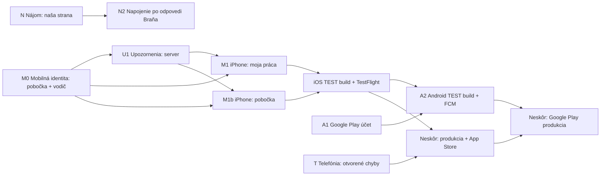

# Plán: upozornenia, mobilná práca, nájom (Braňo) a Android — 28. 10. 2026

Nahrádza poradie v [pláne dokončenia z 27. 10.](dokoncenie-a-appstore-2026-10-27.md) podľa rozhodnutia majiteľa z 28. 10. 2026. Pobočky a Partneri sú hotové na TEST (`dev` `e21cf20`, [Pobočky](../operations/branches.md), PR #514/#515).

## Rozhodnutia majiteľa

| Téma | Rozhodnutie |
|---|---|
| Správa o nehode | **Odložená.** Zdroj SKP ostáva v [podklade](../operations/incident-report-template-input.md). |
| Upozornenia (push) správnemu človeku | **Dokončiť teraz.** |
| Mobilná práca v iPhone appke: jazdy, odvozy, presuny, odťahy | **Dokončiť teraz.** |
| Nájom cez Braňovo API | **Pripraviť našu stranu** a poslať Braňovi neformálny návrh ([e-mail](#e-mail-pre-braňa)). Živé napojenie po jeho odpovedi. |
| Android / Google Play | **Rozbehnúť prípravu a registráciu.** |
| Produkčné vydanie a App Store 1.0 | **Neskôr**, po dokončení týchto celkov a po zosúladení telefonických úprav zo „System health check“ (pozri [riziká](#produkcia-neskôr-čo-si-pamätať)). |

## Poradie a závislosti

M0 je prvý krok (bez neho miestny dispečer a vodič odťahovky nemajú v appke prihlásenie ani push). U1 a N idú súbežne; Android registrácia (A1) beží hneď, lebo overenie účtu trvá dni až týždne. Telefonické chyby (T) sa riešia popri tom a sú podmienkou produkčného vydania.

## M0 — Mobilná identita pre pobočku a vodiča odťahovky

**Prečo prvé:** mobilné API dnes pozná iba dispečera (4 dispečerské roly, `user-bearer`) a pristavovača (`field-bearer` vyžaduje oprávnenie `deliver`, `src/server/mobile/field-auth.ts`). Miestny dispečer (rola `branch`, bez oprávnení) a vodič odťahovky (`drive`) sa do appky neprihlásia, nezaregistrujú si push a príjemcovia push (`pushRecipients`, `pushMemberRecipients` v `src/server/mobile/push.ts`) ich nevyberú.

- `field-bearer` rozšíriť na každé aktívne členstvo; každá route si vyžiada konkrétnu schopnosť (`deliver`, `drive`, miesto miestneho dispečera v pobočke).
- `field/me` vráti schopnosti a pobočky; registrácia push pre každé aktívne členstvo.
- Výber príjemcov podľa miesta v pobočke (miestny dispečer) a podľa `drive` (vodič).
- Shell: `mobile/src/shell/modules.ts` a `field-shell.tsx` dnes poznajú iba Pristavenia; moduly sa zobrazia podľa schopností zo servera (iba prezentácia, server autorizuje každú požiadavku).

## U1 — Upozornenia správnemu človeku (server)

**Stav dnes:** push funguje pre dispečerov (úlohy, prípady, spätné volania) a pre pristavovača pri pôvodnom pristavení (`sendMemberPush` v `src/server/mobile/case-handoff.ts`). Nové jazdy, odvozy, odťahy a Pobočky push neposielajú. Push je „best effort“ po uložení.

**Pravidlá doručenia (kto dostane čo):**

| Udalosť | Príjemca | Zvuk |
|---|---|---|
| Nová požiadavka v pobočke | miestni dispečeri pobočky s „Prijíma novú prácu“ | áno |
| Požiadavka čaká na prevzatie dlhšie ako X min (pobočkou nastaviteľné, predvolene 10) | tí istí + centrála (nastaviteľné) | áno |
| Pridelená jazda / odvoz / presun | iba pridelený vykonávateľ | áno |
| Pridelený odťah (zákazka) | iba pridelený vodič | áno |
| Zmena termínu, zrušenie, prepridelenie preč | dotknutý vykonávateľ | áno |
| Vykonávateľ nahlásil problém / poškodenie | miestny dispečer, ktorý prácu pridelil; pri práci bez pobočky dispečer, ktorý jazdu vytvoril | áno |
| Bežný priebeh (prijal, na ceste, na mieste, hotovo) | nikto plošne; iba stav v aplikácii | nie |

**Ako (bez nového workera):**
- Tabuľka **odchádzajúcich upozornení** (outbox): jeden záznam na udalosť × príjemcu, zapisovaný **v tej istej transakcii** ako príkaz (pobočka, jazda, odťah). Tým sa upozornenie nestratí pri páde medzi uložením a odoslaním.
- Odoslanie hneď po príkaze (existujúci `queueMobilePush`) + **dobehnutie neodoslaných ako ďalšia izolovaná úloha v existujúcom 5-min `/api/telephony/cron`** (rovnako ako dnes spätné volania). Žiadny nový cron ani worker.
- Okamžité odoslanie a dobehnutie si záznam **zamknú** (`for update skip locked` / lease), aby ten istý push neodišiel dvakrát. Dobehnutie má vlastný limit dávky a časový strop (cron má 120 s a push úlohu preskočí po 75 s); výsledok sa zapisuje do súhrnu cronu.
- „Čaká dlhšie ako X min“ nie je udalosť príkazu: vyhodnotí ju tá istá úloha v crone, preto najmenší krok je 5 minút. Nastavenie X pre pobočku a či upozorniť centrálu = nová kolónka pobočky v karte Tím a nastavenie.
- Jedna práca = jeden kľúč upozornenia: jazda prepojená s pôvodným pristavením nepošle push dvakrát (Pristavenia aj Moja práca).
- Pred odoslaním sa znovu overí, že príjemca má ešte prístup (pridelenie/miesto v pobočke). Neaktuálne upozornenie sa zahodí.
- Text bez osobných údajov klienta; ťuknutie otvorí konkrétnu prácu (`PushTarget` rozšíriť o `operation`, `towing`, `branch-request`).
- Nové druhy v nastaveniach Účtu: „Práca pobočky“, „Moja práca“.
- Odoslanie push nie je prijatie práce; stav v aplikácii zostáva zdrojom pravdy.

**Databáza:** outbox, nastavenie eskalácie pobočky a zápis upozornení vo vnútri `motorist_branch_command`, `motorist_operations_command` a odťahového príkazu (nové verzie funkcií). Presné SQL pripravím na schválenie pre TEST; produkčný zoznam migrácií sa tým predĺži.

**Hotové, keď:** pád po uložení nestratí upozornenie (dobehne cron), opakovanie nepošle dvakrát tú istú udalosť, iná pobočka nič nedostane, odobratý človek nič nedostane. Kontraktný test na lokálnom PostgreSQL + jedno doručenie na fyzický iPhone v TEST.

## M1 — iPhone: moja práca (vykonávateľ)

Nový natívny modul **Moja práca** podľa [mobilného štandardu](../mobile/design-standard.md), manifest v `mobile/src/shell/modules.ts`.

- Zoznam vlastných pridelených jázd, odvozov a presunov (z `motorist_operations`) a vlastných odťahových zákaziek, zoradený podľa termínu.
- Detail: kam, kedy, auto, kontakt (volanie/navigácia), pokyny.
- Kroky jazdy: Prijať → Začať → Som na mieste → (Vozidlo prevzaté) → Dokončiť; zachované potvrdenky príkazov a ich opakovanie offline.
- Doklady: fotografia, km, palivo, poškodenie s fotkou alebo dôvodom, kto prevzal.
- Odťah: Začať → doplniť priebeh, fotky práce/odovzdania, sken papiera → Odovzdať na kontrolu. Nacenenie a fakturácia ostávajú v kancelárii (web).
- Poloha počas prijatej jazdy: dnešné ukladanie polohy a tracker patria k pôvodným pristaveniam, preto treba **polohu na úrovni jazdy** (nová tabuľka/route, rovnaké pravidlá 30 dní a len počas prijatej jazdy).
- **Server:** nové `field-bearer` API (`/api/mobile/v1/field/operations…`, `/api/mobile/v1/field/towing…`), ktoré volajú existujúce RPC jázd a odťahov; priebeh, doklady a financie sa nemenia.
- **Súkromie:** texty povolení (poloha je dnes písaná iba pre pristavenie, fotoaparát pre prílohy prípadu), privacy manifest a stránka `/aplikacia/sukromie` sa rozšíria o jazdy, odvozy a odťahy (fotky, km, poškodenia). Mení sa natívny build.
- Pôvodný modul Pristavenia a starší build zostávajú funkčné.

## M1b — iPhone: Pobočka (miestny dispečer)

Malý modul **Pobočka**: front na prevzatie, Prevziať, Prideliť (vykonávateľ zo svojej pobočky), zoznam prebiehajúcej práce. Reporty a nastavenia ostávajú na webe. Volá existujúce `motorist_branch_*` RPC cez rozšírené `field-bearer` API z M0 (miesto miestneho dispečera overí server).

**Hotové (M1 + M1b), keď:** na fyzickom iPhone v TEST: push → ťuk otvorí prácu → vykonávateľ prejde kroky s fotkou → kancelária vidí doklady; miestny dispečer prevezme a pridelí z mobilu. Nový iOS TEST build cez TestFlight (Beta App Review len ak to Apple vyžiada).

## N — Nájom cez Braňovo API (naša strana pripravená)

**Teraz (bez Braňa):**
- **Nájomný zámer** pri pristavení: stabilné ID, revízia, väzba na prípad a jazdu; jeden prípad môže mať viac zámerov (výmena auta).
- **Mapovanie** našich údajov na draft (klient, asistencia + číslo, pobočka, termín a miesto, auto ak je známe) a **náhľad**, čo by sa odoslalo.
- **Adaptér** s jasným stavom `nepripojené` → po napojení `čaká / nejasné / draft vytvorený (externé ID, odkaz)`. Nikdy falošné „prenesené“, bez druhého create po timeoute, ak cieľ nepodporuje overenie podľa našej referencie.
- Tlačidlo v detaile jazdy/prípadu „Pripraviť nájom“, ktoré dnes ukáže náhľad a stav „čaká na napojenie“.

- Braňov systém je podľa doterajších podkladov **SWHouse**, ktorý dnes iba čítame (`src/server/integrations/swhouse/`, len GET). Adaptér použije jeho existujúcu konfiguráciu a mapovanie pobočiek a áut; potvrdiť pri odpovedi.

**Po odpovedi Braňa (N2):** konkrétny HTTP adaptér na jeho TEST rozhranie s rovnakými ochranami ako ostatné živé integrácie (iba dedikovaný TEST projekt, overená TEST identita cieľa, bez produkčných kľúčov). Spoločná ukážka podľa [technických požiadaviek](poziadavky-pre-brana-2026-10-27.md), ktoré mu pošleme až po tom, čo potvrdí záujem.

### E-mail pre Braňa

> **Predmet:** Prenos pristavení z dispečingu do vášho systému ako draft
>
> Ahoj Braňo,
>
> pri dispečingu teraz riešime jednu vec, ktorá nás pri pristaveniach najviac zdržiava: ľudia prepisujú tie isté údaje z dispečingu ručne do vášho systému. Chceli by sme, aby sa po pridelení pristavenia v našej aplikácii **automaticky vytvoril u vás rozpracovaný nájom (draft)**, označený ako **„Prenesené z dispečingu“**. Pristavovač by ho u vás iba otvoril, skontroloval a doplnil, čo chýba. Žiadne prepisovanie z jednej aplikácie do druhej.
>
> **Čo by sme k vám preniesli (základ):**
> 1. Označenie „Prenesené z dispečingu“, naše číslo prípadu a jedinečný identifikátor prenosu (aby opakované odoslanie nevytvorilo druhý draft).
> 2. Objednávateľa / asistenčnú službu a jej číslo prípadu.
> 3. Klienta: meno alebo firmu, telefón, prípadne e-mail.
> 4. Vozidlo klienta: EČV, značku a model.
> 5. Náhradné auto, ak je už vybrané (EČV alebo vaše ID auta) — draft by mal vedieť vzniknúť aj bez neho.
> 6. Pobočku, ktorá pristavenie robí.
> 7. Termín a miesto pristavenia, prípadne predpokladaný návrat.
> 8. Pristavovača, ktorý auto odovzdá, a poznámku k pristaveniu.
>
> Rodné čísla, doklady, fotky ani nahrávky by sme neposielali. Naspäť by nám stačilo číslo draftu, jeho stav a ideálne odkaz, aby sme vedeli, že vznikol.
>
> **Otázky:**
> - Dá sa takýto draft vytvoriť cez vaše API? Ak áno, aké polia sú povinné a vie vzniknúť aj bez vybraného auta?
> - Nerozbije to u vás niečo, napríklad číslovanie nájmov, štatistiky alebo obsadenosť áut? Draft by nemal blokovať auto, kým ho pristavovač nepotvrdí.
> - Žiadal si od nás prístup k API na register vozidiel (dohľadanie auta podľa EČV). Používaš ho už reálne? Na čo ho využívaš a čo robíš s údajmi o vozidlách, ktoré cez neho dohľadáš?
>
> **K vozovému parku:** naša aplikácia už rieši celý vozový park. Pri každom aute je kompletný prehľad: história jázd a prenájmov, platnosť STK a emisnej kontroly, poistenie a diaľničná známka, fotky, opravy a poruchy, poškodenia a ich riešenie, aktuálny stav a pripravenosť auta, poloha z GPS a obsadenosť. Zoznam áut a obsadenosť pritom čítame z vášho systému. Riešiš niečo z toho aj ty? Nechceme robiť duplicitu, takže by sme sa radi dohodli, čo bude viesť ktorý systém.
>
> Celkovo: dáva ti to zmysel? Vidíš nejaký problém, alebo by si to navrhol inak? Ak áno, pošlem ti podrobnejší technický návrh a dohodneme sa na testovacom prístupe. Pokojne to prejdime aj telefonicky.
>
> Vďaka,
> …

## A — Android a Google Play

**A1 — účet a registrácia (majiteľ, hneď):**
- Google Play Console **organizačný účet** na MICT, s.r.o. (jednorazový poplatok 25 USD). Údaje sa overujú voči D-U-N-S; Apple organizačný účet MICT ho vyžadoval, takže by mal existovať (overiť zhodu názvu a adresy). Overenie môže trvať dni až týždne.
- Organizačný účet nemá povinné 14-dňové uzavreté testovanie s 12 testermi, ktoré platí pre nové osobné účty.
- Google zavádza povinné overenie vývojára aj pre aplikácie mimo Play (od 30. 9. 2026 vo vybraných krajinách, globálne 2027). Overený Play účet je základ; balíky aplikácie môže byť potrebné v Play Console ešte zaregistrovať.

**A2 — technika (my):**
- Android package `sk.linkapomoci.dispecing.test` (TEST) a `sk.linkapomoci.dispecing` (produkcia) už sú v `mobile/app.config.ts`; TEST APK M1 existuje.
- **Firebase projekt + FCM** pre Android push: `google-services.json` pre každý variant (`android.googleServicesFile` v `app.config.ts`) a FCM kľúč v Expo/EAS; bez nich Android notifikácie nefungujú.
- `eas.json`: Android TEST profil pre **Play internal testing** (AAB namiesto APK) a Android submit profil s kľúčom servisného účtu Play. Prvé nahratie do Play Console je ručné.
- Cieľová úroveň API: nové aplikácie od 31. 8. 2026 musia cieliť na Android 16 (API 36); Expo SDK 57 to spĺňa, overí sa pri builde.
- Poloha na pozadí počas jazdy: dnes je na Androide blokovaná, takže **na Androide sa poloha posiela iba pri otvorenej appke**. Plnú polohu na pozadí možno pridať neskôr; Play pre ňu vyžaduje vyhlásenie a video.
- Telefonovanie na Androide (Telnyx/FCM hovory) je samostatná neskoršia etapa; prvý Android build = prípady, úlohy, moja práca, pobočka, push.

**Distribúcia:** Play nemá ekvivalent iOS „unlisted“. Na TEST **internal testing** (do 100 testerov). Pre ostrú prevádzku buď **verejný záznam s prihlásením**, alebo **súkromná aplikácia cez Managed Google Play** (iba pre organizácie s Android Enterprise). Rozhodne sa pri produkcii.

## Produkcia neskôr: čo si pamätať

Stav overený 28. 10. 2026 (workspaces „System health check #8–#27“, git, produkčná databáza iba na čítanie):

- **Health checky nič nemenili.** Boli to denné kontroly produkcie iba na čítanie. Telefonické opravy vznikli v iných workspaceoch (PR #441–#460) a sú **iba v `dev`/TEST**.
- **`main` je celý obsiahnutý v `dev`.** Na produkcii nie je žiadna oprava, ktorá by v `dev` chýbala, takže vydanie nič späť nepokazí. Riziko je **veľkosť**: 148 zmien (bez zlučovacích commitov) a 18 migrácií, ktoré produkčná databáza ešte nemá (odťahy, push zariadenia, pristavenia, jazdy, partneri, pobočky). Žiadna z migrácií nie je telefonická.
- **Produkcia dnes ešte nemá tieto opravy z `dev`:** spojené hovory sa nesprávne zapisujú ako „opustené vo fronte“ (#450); pomalá podúloha zhodí celý cron (#450, #442); timeouty čítania aktívnych hovorov (#444); chyby pripojenia telefónu v prehliadači (#441); oneskorenie zámku hovoru a webhookov (#452, #458, #460).

**T — telefónia: vyriešiť alebo vedome prijať pred produkciou**

| Otvorené | Stav |
|---|---|
| Príkazy posielané na už ukončený hovor (Telnyx 90018) | iba diagnostikované |
| Duplicitný zápis udalosti hovoru (~6 × 409 denne) | otvorené na oboch vetvách |
| Upozornenie Node `url.parse()` na Telnyx webhooku | zdroj nenájdený |
| Realtime „Unauthorized“ a `refresh_token_already_used` | otvorené |
| Zbytočne časté obnovovanie (skryté karty, história hovorov) | otvorené |
| **Produkčné Telnyx webhooky idú na `dispecing-test.vercel.app`** namiesto `dispecing.linkapomoci.sk` | otvorená konfigurácia u providera |
| Nahrávanie a živé audio | funkčne neoverené; na TEST hovor nahrávku nevytvoril (#450) |

Po vydaní sledovať: dĺžku spoločného `/api/telephony/cron` (limit 120 s, pribudli push úlohy), zmenené poradie hold/park príkazov, nové databázové limity 1 s / 4 s.

**Spôsob vydania (rozhodne sa pri produkcii):** (a) celý `dev` naraz s 18 migráciami, alebo (b) najprv **menšie izolované telefonické vydanie** z `main` s PR #441, #442, #444, #450, #452, #454, #456, #458, #460 (rovnako ako #436/#438) a moduly až potom. Variant (b) prinesie produkcii telefonické opravy skôr a s menším rizikom.

Ďalej: produkčné premenné (`MOTORIST_TOWING_ENABLED`, `MOBILE_PUSH_ENABLED`, `MOBILE_DELIVERY_ENABLED`), produkčný hlas pre iPhone (dnes iba TEST), App Store karta `sk.linkapomoci.dispecing` a review účet. Postup podľa [release workflow](../operations/release-workflow.md) a výslovné schválenie majiteľa vrátane presného SQL.

## Overovanie (primerane)

Každý celok: lokálny kontraktný test dotknutých RPC, existujúca Vercel brána (vitest, typecheck, build), jedna ukážka na TEST so syntetickými dátami. Fyzický iPhone iba pre push, kroky v teréne a polohu. Bez opakovania nezmenených častí.

## Čo potrebujem od majiteľa

1. **Google Play Console**: založiť organizačný účet MICT (alebo mi dať pozvánku do existujúceho) — vyžaduje platbu a overenie totožnosti.
2. **Odoslať e-mail Braňovi** (text vyššie).
3. **TEST databáza:** nové migrácie pre M0, U1, M1 a N budem nahrávať iba do TEST (`nzpnqdstvkfncflgqlny`) pri nasadení na TEST; produkčná databáza sa nemení.
4. Na fyzický test: jeden iPhone s TEST appkou (TestFlight) ako vykonávateľ a druhý účet ako miestny dispečer; neskôr jeden Android telefón.
