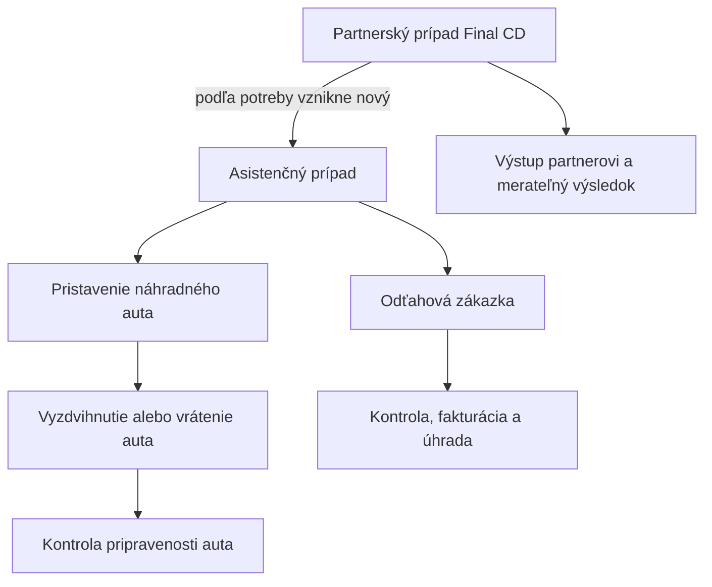

# Spoločná aplikácia: Final CD, výjazdy a vozový park

**Aktuálny realizačný kontrakt:** [finálny plán po RALPLAN revízii](spolocna-aplikacia-20261026.md), vrátane schváleného PRD, test-spec a ADR. Nižšie zostáva produktový podklad, zdrojová matica a kritériá A01–A24 spred konsenzu. Pri rozdieloch v technickom postupe majú prednosť finálne kontrolované artefakty.

**Stav: návrh realizačného plánu · 26. 10. 2026.** Zadanie tejto práce je znovu prečítať mítingy a workspace „Náhradné vozidlo plán vývoja“, zosúladiť ich s dnešným kódom a pripraviť plán. Tento dokument nepovoľuje nové SQL, provider zápisy ani nasadenie. Terajší návrh realizácie uprednostňuje **web v existujúcej aplikácii**; dnešný mobil zostáva kompatibilným klientom.

## Requirements Summary

Výsledkom má byť jedna pracovná aplikácia so spoločným prihlásením a modulmi podľa používateľa: dispečing, pristavenia a odvozy, odťahové zákazky a flotila. Final CD a ďalší partneri sa pripájajú k rovnakému toku prípadov. Od klientovho nahlásenia cez pridelenie a vykonanie až po partnerský výstup alebo fakturáciu sa údaje dohľadávajú bez opakovaného prepisovania. Tento zámer je výslovný v pôvodnom mítingu (S1, časť 1, 04:18–04:59 a 49:48–50:29) aj v novšom (S3, 02:28–02:38).

Zachovávajú sa tri piliere, ktoré majiteľ spresnil v druhom workspace: **1. Final CD; 2. odťahy, pristavovanie a poloha; 3. vozový park, poškodenia a kalendár** (S2). Novšia požiadavka pridáva konkrétny návrh odvozov a spoločné webové rozhranie. Nižšie uvedené poradie je návrh, historické termíny zo starého plánu nie sú nové záväzky.

### Spoločná realizácia Final CD, odťahov a pristavení

**Odporúčanie po doplnení majiteľa: prvé dva piliere navrhnúť a realizovať ako jeden ucelený webový rozsah.** Odťahy sa dokončia spolu s prepojením na dispečing; Final CD sa zapojí do rovnakého pracovného toku. Označenia M1/M2 nižšie pomenúvajú časti práce, nie povinnosť dokončiť celý Final CD projekt pred začatím odťahov.

| Spoločný základ | Osobitná časť |
| --- | --- |
| Prihlásenie, práva, klient, partner, prípad a jeho nadväznosti | Final CD: partnerský pohľad, komunikácia so servisom a vlastný obchodný výsledok. |
| Pridelenie, trasa, termín, stav, história a dôkazy vykonania | Odťah: technika, zloženie vozidla, zákazkový list a Erosova kontrola/fakturácia/úhrada. |
| Vozidlo, vykonávateľ, kontakty a priebeh práce | Pristavenie/odvoz: konkrétne náhradné auto, odovzdanie, návrat a kontrola pripravenosti. |
| Prepojený prehľad a reporty | Samostatný platiteľ a vyúčtovanie každej skutočne dohodnutej služby. |

Final CD bude prvým konkrétnym partnerom nad spoločným modelom. Ďalší díler dostane vlastnú konfiguráciu, kontakty a povolené prípady v tej istej aplikácii. Podľa tejto hranice sa navrhuje spoločný základ raz, bez zavádzania univerzálneho systému pre nepotrebné procesy.

**Akceptačný cieľ spoločného rozsahu:** prichádzajúci hovor Final CD → partnerský prípad → podľa potreby prepojený asistenčný prípad → odťah a/alebo pristavenie → odovzdanie servisu/klientovi → partnerský výstup a samostatné vyúčtovanie → neskorší odvoz a kontrola náhradného auta. Ak asistencia alebo náhradné auto nie sú potrebné, prípad sa ukončí príslušným jednoduchším výsledkom.

Realizácia pôjde cez menšie PR a priebežné TEST vydania. Kompletnosť tohto rozsahu sa hodnotí spoločným scenárom A24 aj kontrolami jednotlivých častí. Rozšírená flotilová administratíva a prenájmový kalendár ostávajú nadväzujúcimi etapami; ich dokončenie nie je podmienkou tohto pracovného toku.

### Prečítané podklady a ich váha

| ID | Zdroj | Čo z neho používame |
| --- | --- | --- |
| **S1** | [Pôvodný prepis](../../.context/planning-sources/meeting-2026-10-18-recovered.txt), 1 602 riadkov; [pôvodný workspace](conductor://workspace?id=eb7941f8-99ff-4793-9b98-0d0b3f4e7b97&session=5b71dc9f-c523-4e12-a174-31c442889f67) | Požiadavky klienta a ich kontext. Text bol obnovený zo siedmich pôvodných čítaní prílohy; číslovanie je súvislé, obsahová medzera v nahrávke tým nie je doplnená. |
| **S2** | Ten istý workspace, správa majiteľa `4c66513b-f335-417d-8f5b-9eb6a0de1b71`, index 234; lokálna [získaná diskusia](../../.context/planning-sources/nahradne-workspace-discussion.md) | Výslovné spresnenie troch pilierov, Eros = Matej Červený, SWHouse = Braňov systém. Vylúčenie zmien zvonenia Natália/Mango. Poradie vývoja vtedy ešte nebolo uzavreté. |
| **S3** | [Novší prepis, príloha z 23. 10.](../../.context/attachments/assets/aeb9f580-9d1b-422c-846f-8084ab4736af/pasted_text_2026-10-23_19-52-11.txt), 316 riadkov | Jednoduchá spoločná aplikácia, základ prípad → konkrétny vykonávateľ, priorita Final CD, partnerské webové zobrazenie a správa o nehode. |
| **S4** | [Erosovo zadanie a zákazkový list, získaný text](../../.context/planning-sources/eros-and-work-order-documents.txt) | Minimum údajov pri zadaní, práca vodiča, kontrola, položky, fakturácia, úhrady, fotky a potvrdenie odovzdania. Pôvodné Word prílohy sú vo workspace S1; obnovený text neobsahuje ich obrázky. |
| **S5** | [Predchádzajúci plán troch pilierov](../../.context/planning-sources/previous-plan-tri-piliere-2026-10-18.md) a záverečná správa `1e4a58c9-d232-44dc-9fb5-a1b1d226050c` vo workspace S1 | Historický návrh a inventúra z 18. 10. Každé tvrdenie o dnešnom stave sa kontroluje oproti novším zdrojom a kódu. |
| **S6** | [Aktuálny návrh logistiky](../../DESIGN.md), [zmena prvej fázy z 24. 10.](../rollout/mobile-phase-one-2026-10-24.md:3), [akceptačný checklist](../mobile/phase-one-acceptance.md:3), [odťahový runbook](../operations/towing-work-orders.md:3) | Existujúce stavebné prvky a hranica medzi implementáciou a prevádzkovým overením. |

Obnovené podklady sú miestne pracovné prílohy v gitignorovanom `.context/`; uchováva sa aj pôvodný Conductor odkaz a identita správy. Nejde o prevzaté pokyny na vykonanie akcií ani o dôkaz aktuálneho živého nasadenia. Kód bol preverený v checkoute `f62ea2a`; pred implementáciou sa znovu porovná aktuálny `dev` a `main`.

**Neúplnosť prepisu:** v S1 časť 1 po 2:04:20 obsahuje už len útržky do 2:46:31. Koniec časti 2 v 1:19:30 nedokazuje ďalšiu nahrávku. Majiteľ výslovne uviedol, že časť 3 podľa neho neexistuje (S2). Vývojový plán sa preto neblokuje žiadosťou o nepreukázanú časť 3.

### Čo z predchádzajúcich návrhov treba opraviť

| Starší predpoklad | Zjednotený záver a dôkaz |
| --- | --- |
| Pristavovač a jeho GPS sa ešte len majú vybudovať. | Jadro odovzdania, priebehu a polohy je v súčasnom kóde. Nová práca je najmä spoločný webový prehľad, webový pracovný priestor pristavovača a viac samostatných úkonov. [Webový handoff](../../src/server/web-case-handoff.ts:10), [mobilná dodávka](../../src/server/mobile/delivery.ts:44). |
| Mobilná flotila stále padá nad 200 áut. | Opravu a podporu do 1 000 vozidiel dokumentuje vydanie z 24. 10.; nepísať ju druhýkrát ako novú úlohu. [Záznam](../rollout/mobile-phase-one-2026-10-24.md:7). |
| Jeden prípad s viacerými úkonmi vyrieši všetky väzby. | Navyše treba vzťah **partnerský konzultačný prípad → nový nadväzujúci asistenčný prípad**, keď sa mení služba/objednávateľ; oba zostanú merateľné. S1, časť 1, 01:15:17–01:16:49, riadky 589–593. |
| Pristavenie je úplne rovnaká zákazka ako odťah. | Spoločné je pridelenie, ľudia, trasa a história. Odťah má vlastné vykonanie, kontrolu, fakturáciu a úhradu; návrat náhradného auta má osobitné prevzatie, doručenie a kontrolu pripravenosti. [Dnešné oddelené stavy](../../src/domain/towing/types.ts:5), S4, riadky 112–116. |
| Kompletná kniha poškodení musí predchádzať pristaveniam. | Základné hlásenie poškodenia patrí už k práci pri aute. Úplná správa opráv, poisťovní a súčtov príde v treťom pilieri. S1, 43:26–44:37 a 54:28; S3, 27:33 a 38:57. |
| Termíny november/január/február zo starého plánu sú schválené. | Sú to návrhy autora. Doložený prevádzkový cieľ je kniha odťahov „od prvého januára“; tento plán interpretuje rok ako **1. 1. 2027** podľa dátumu mítingu. S1, 51:35, riadok 428. |
| Jedna aplikácia znamená zlúčiť všetky databázy firmy. | Zjednocuje sa pracovná aplikácia a povolené procesy. Prenájmy zostávajú v SWHouse; samostatná poľská aplikácia a Watchdog zostávajú mimo tejto realizácie. S2 a [pravidlá projektu](../../AGENTS.md). |

## Cieľový tok a zodpovednosť za údaje

- **Partner, klient a platiteľ sú rôzne údaje.** Final CD môže byť obchodný pôvod prípadu, klient volajúci človek a následný odťah môže hradiť asistenčka. Pôvodný partnerský prípad sa tým neprepíše na inú firmu. S1, riadky 589–593 a 1406–1420.
- **Jeden prípad → viac realizačných úkonov.** Odťah a pristavenie môžu prebiehať súčasne s inými vodičmi; odvoz príde neskôr. Každý úkon má vlastnú identitu, termín, priradenie a históriu. Dnešné `sourceCaseId` je východisko väzby odťahu, nie hotový model celého reťazca. [Typ zákazky](../../src/domain/towing/types.ts:25), S1, 12:32–16:02.
- **Jedna realizácia → jeden hlavný realizačný záznam.** Spoločný prehľad odkazuje na existujúcu zákazku/handoff; nevytvára druhé nezávislé potvrdenie tej istej práce. Pri odvoze odťahovkou sa logistický úkon previaže s realizačnou zákazkou a výkon sa nezapočíta dvakrát. [Dnešné modely](../../src/domain/case-handoff.ts:23), [odťahy](../../src/domain/towing/types.ts:24).
- **SWHouse vlastní prenájmovú obsadenosť.** Lokálny dispečing vlastní plán práce, svoje blokácie, pridelenia a vykonanie. Commander/WebDispečink/telefón dodávajú polohu a dostupné merania, nie pravdu o prenájme. [Význam zdrojov](../live-fleet.md:3), [oddelené stavy](../../src/domain/types.ts:519).
- **Stála logistická práca sa oddelí od dočasného prístupu.** Expirácia odkazu nesmie odstrániť budúci odvoz. Dokončenie jazdy samo neukončí interný prípad, prenájom ani fakturáciu. [Expirácia dnešného handoffu](../../src/domain/case-handoff.ts:45), [oddelené financie](../../src/domain/towing/types.ts:5).

## Implementation Steps

### M0 — Základ a hranice prvej realizácie

**Výstup:** dohodnutý slovník a minimálny dátový/prístupový kontrakt. Podklady sú spracované týmto plánom; rozhodnutia uvedené nižšie sa uzatvárajú pri príprave príslušného vydania.

1. Porovnať aktuálny `dev`, `main` a skutočné nasadenia. Inventúru v tomto pláne nepovažovať za vzdialený deployment audit. Použiť [release workflow](../operations/release-workflow.md) a existujúci [checklist jadra](../mobile/phase-one-acceptance.md:3).
2. Určiť konkrétnu identitu partnera, auta/cyklu používania, úkonu, jeho vykonávateľa a väzby medzi prípadmi. Oddeliť prijatie práce od samotného pridelenia. Východiská: [prípady](../../src/domain/types.ts:638), [handoff](../../src/domain/case-handoff.ts:23), [odťahové členstvo a zákazka](../../src/domain/towing/types.ts:2).
3. Zapísať minimálnu tabuľku práv: dispečer/koordinátor podľa povolených pobočiek; pristavovač vlastné pridelenia; vodič odťahovky iba so schopnosťou odťahu; fakturant financie; správca flotily technické údaje; partner len výslovne sprístupnené prípady. Roly nerozširovať iba kvôli spoločnému menu. S1, 39:33–39:59; [dnešné capabilities](../../src/domain/towing/types.ts:3).
4. Potvrdiť rozdiel medzi údajmi potrebnými na rýchle vyslanie a údajmi na dokončenie. Povoliť minimálny návrh s kontaktom a miestom; chýbajúce položky dožiadať v správnom kroku. S4, riadky 112–114; [dnešné formuláre zákazky](../../src/components/towing/OrderFields.tsx).

**Závislosti:** potvrdenie pracovných názvov a práv, nie plný kalendár alebo nájomný protokol. Nový webový vývoj nemusí čakať na fyzický mobilný pilot, ktorý majiteľ odložil; existujúce fyzické skúšky tým zostávajú otvorené. [Záznam](../rollout/mobile-phase-one-2026-10-24.md:26).

### M1 — Final CD: prvý uzavretý partnerský tok

**Výstup:** hovor na partnerovu linku → správne označený prípad → poskytnutá pomoc → výstup konkrétnemu servisnému kontaktu → dohľadateľný výsledok. Priorita je doložená S2 a S3, 24:58–25:15.

1. **Väzba linka → partner v adresári.** Podľa skutočne volanej linky predvyplniť partnera, zachovať možnosť opravy a oddeliť ho od klienta/platiteľa. Kód pozná identitu linky, no editor má len voľný `partnerName` a nový prípad začína s prázdnou firmou. [Hovor](../../src/domain/types.ts:620), [editor linky](../../src/server/telephony/line-workspace-service.ts:10), [formulár](../../src/components/dispatch/NewCaseDrawer.tsx:147).
2. **Partnerský výstup.** Pridať výslovné „Odovzdať partnerovi“ s náhľadom kontaktu, udalosti, poskytnutej pomoci a odporúčaného servisu. Prvé použiteľné vydanie môže odosielať potvrdený e-mail/PDF a evidovať výsledok; úplný partnerský portál nie je jeho podmienkou. PDF prípadu existuje a odťahy majú použiteľný vzor evidencie odoslania. [PDF](../../src/app/api/cases/[id]/pdf/route.ts:9), [e-mailový vzor](../../src/server/towing/documents.ts:78); S1, časť 2, 47:58–51:17 a 56:17–59:19.
3. **Nadväzujúci prípad.** Pri dohodnutej následnej asistencii vedome založiť nový prepojený prípad s vlastným platiteľom/asistenčkou a jej referenciou. Pôvodný partnerský záznam ostáva zachovaný; prechádzať možno oboma smermi. Dnešný `DispatchCase` nemá všeobecnú väzbu na nadväzujúci prípad. [Model](../../src/domain/types.ts:638); S1, riadky 589–593.
4. **Obchodný výsledok a meranie.** Partnerský prípad má vlastný výsledok a podklad na zúčtovanie, nezávislý od následného odťahu alebo náhradného auta hradeného asistenčkou. Rozlíšiť odporučenie servisu, odovzdanie údajov a skutočne potvrdené prijatie vozidla servisom tam, kde je relevantné. Bezplatnosť, podmienka účtovania a sadzba sa riadia potvrdenou dohodou; suma 30–50 € spomenutá v mítingu nie je schválený cenník. Report za partnera a obdobie oddelí hovory, konzultačné prípady, ich výsledky a následné výkony; každá jazda nie je ďalší Final CD prípad. Základ reportov už existuje, partnerský výstup sa musí doplniť. [Dashboard](../../src/app/api/reports/dashboard/route.ts:18), [štatistiky liniek](../../src/server/telephony/stats.ts:239); S1, časť 2, 01:14:33–01:15:28.
5. **Partnerský web v spoločnom rozsahu:** jednoduchý zoznam vlastných sprístupnených prípadov a ich výsledkov. E-mail/PDF umožní skoršie skúšky, no celý spoločný partnerský rozsah sa neoznačí za hotový iba odosielaním e-mailov. Dnešný `/handoff` poskytuje jednu kartu, nie partnerský zoznam. Práva partnera sa určia pred týmto vydaním. [Existujúca karta](../../src/app/handoff/page.tsx:1), S3, 25:15–25:42.
6. **Správa o nehode:** samostatný dokumentový tok s odkazom pre klienta, návratom vyplnených údajov k správnemu prípadu a výstupom pre klienta/dispečera. Patrí do partnerského rozsahu; podrobné polia a výsledný dokument sa pripravia podľa vzoru dodaného klientom. Dodanie vzoru neblokuje nezávislé vydanie odťahov, otvorená dokumentová časť sa však uvedie v odovzdaní. Nie je to hlásenie poškodenia flotilového auta. S3, 25:42–26:04.

Nastavenie konkrétnych čísiel, hlášok a presmerovaní sa overí pri tomto vydaní; historická diagnóza starého hovoru nie je dôkaz dnešnej chyby. Nastavenie zvonenia Natália/Mango ostáva podľa S2 mimo rozsahu. Prichádzajúce SMS z S3, 19:35–20:54 sú osobitný integračný bod na overenie poskytovateľa, nie podmienka doručenia partnerského výstupu.

### M2 — Odťahy, pristavenia a odvozy v jednej webovej aplikácii

#### M2a — Spoločné pracovisko a prepojený prehľad

**Výstup:** v spoločnej navigácii sú **Pristavenia a odvozy** a **Odťahové zákazky**. Flotila a prípad otvárajú tie isté úkony. Vykonávateľ má vlastné **Moje jazdy** bez ďalšieho prihlásenia. Návrh obrazoviek je v [DESIGN.md](../../DESIGN.md).

1. Využiť existujúci shell a menu; nové obrazovky načítavať podľa aktuálneho modulu a práv. Prepnutie nezruší hovor ani rozpracovaný prípad. Dnes má towing vlastný shell a pristavovač bez dispečerského profilu nemá webový cieľ. [Navigácia](../../src/components/dispatch/DispatchConsole.tsx:878), [smerovanie](../../src/app/page.tsx:19), [hranice towing UI](../../src/components/towing/README.md:1).
2. Nad existujúcimi realizačnými záznamami vytvoriť autorizovaný organizačný zoznam: termín, typ, auto, trasa, klient/prípad, vodič, stav, ETA a problém. Podporiť Nepridelené, Dnes, Mešká a Návraty bez dohody. Existujúci handoff sa dnes číta po jednotlivom prípade; zoznam sa nemá skladať sťahovaním všetkých detailov. [Webový vstup](../../src/server/web-case-handoff.ts:10), [per-case panel](../../src/components/dispatch/CaseHandoffPanel.tsx:14).
3. Pridať vlastný webový vstup pre `deliver` bez vytvorenia dispečerského profilu. Server overí člena, pridelenie a akciu; vodič nenatiahne celý dispečerský dataset. [Existujúca terénna identita](../../src/server/mobile/field-auth.ts:12), [dnešná voľba vodiča odťahu](../../src/components/towing/OrderDetail.tsx:69).
4. Základné kolízie: plánovaný začiatok a koniec práce vrátane presunu. Neznámy koniec je dovolený, ale budúca kapacita nie je potvrdená. Dnešné `scheduledAt`/`plannedAt` nepokrývajú plný interval; ide o nové rozšírenie. [Handoff](../../src/domain/case-handoff.ts:10), [towing časové polia](../../src/domain/towing/types.ts:14); S1, 35:37.
5. Zachovať existujúci kontrakt mobilných odovzdaní a jeho životný cyklus. Nové webové typy úkonov alebo rozšírené údaje sa nepridajú nekompatibilne do odpovedí starému klientovi; oddelia sa alebo verziujú. Webová etapa nevyžaduje novú natívnu binárku. [Kontrola dnešnej odpovede](../../src/server/mobile/delivery.ts:44), [mobilné typy](../../src/lib/mobile-api.ts:440).

#### M2b — Eros: kniha odťahov a januárový štart

**Výstup:** z dispečingu sa odovzdá reálna zákazka, vodič ju vykoná a kancelária ju skontroluje, nacení, vyfakturuje a zaeviduje úhradu. Ide o dokončenie existujúceho modulu, nie nový fakturačný systém. [Súčasný runbook](../operations/towing-work-orders.md:18), S4, riadky 112–116.

1. Z prípadu pridať „Zadať odťah“: vytvoriť alebo otvoriť jedinú súvisiacu zákazku a prideliť vodiča. Pri opakovaní nevytvoriť duplikát. Stav zákazky je viditeľný na prípade; snapshot sa aktualizuje vedome. [Existujúci prehľad](../../src/components/towing/TowingWorkspace.tsx:95), [vedomé obnovenie](../../src/components/towing/OrderDetail.tsx:69); S1, 49:28–51:35.
2. Doplniť potvrdené rozdiely voči Erosovmu zadaniu: objednávateľ a jeho referencia na karte, km, čas začatia/ukončenia, spôsob úhrady a položky so sumami bez/s DPH. Staré zoznamy chýb overiť aktuálne a opraviť len pretrvávajúce medzery. [Dnešné polia](../../src/domain/towing/types.ts:11), [karta vodiča](../../src/components/towing/OrderDetail.tsx:70), S4.
3. Fotografický dôkaz a odovzdanie servisu: navrhnuté minimum dve fotky, fotka potvrdeného papierového dokladu ako podporovaný postup; oprávnenia vodiča overiť testom. Potvrdiť povinné údaje podľa typu výkonu. Digitálny podpis nie je podmienkou prvej verzie. [Typy príloh](../../src/domain/towing/types.ts:20), S1, 01:50:04–01:55:01; S4, riadok 185.
4. Vykonanie, kontrola/nacenenie, fakturácia a úhrada majú samostatné výsledky. Prehľad môže mať zrozumiteľné farebné označenie podľa Erosovho vzoru, no zachová čiastočné platby a prípady bez fakturácie. [Stavy](../../src/domain/towing/types.ts:5), [dnešné popisy](../../src/components/towing/model.ts:5), S4, riadky 200–207.
5. AWP režim eviduje zákazku bez duplicitného odoslania vodičovi. Import nemusí byť automatický v prvom vydaní; režim „vykonanie evidované v AWP“ musí byť explicitný. S1, 01:26:04–01:26:50, riadky 655–668.
6. Existujúcu evidenciu faktúr, úhrad a hotovosti zachovať. Export pre Omegu pripraviť až podľa potvrdeného importného formátu Peťky; hotovosť a platby nezamieňať za vystavenie faktúry. [Dnešné financie](../../src/domain/towing/types.ts:22), [runbook](../operations/towing-work-orders.md:22); S1, 01:44:41–01:48:28.
7. Pilot s Erosom na TEST nad skutočnými pracovnými scenármi a klientom potvrdeným PDF. Historický zákazkový list je obsahový podklad; texty výslednej verzie musí klient potvrdiť. Dodať schválené číselníky a pripraviť súbežnú prevádzku s Excelom pred cieľom **1. 1. 2027**. S4 a S1, 51:35.

M2b má pri kolízii kapacity prednosť pred širokou flotilovou administratívou. Nový kalendár, rozšírené partnerské funkcie ani automatický zápis do SWHouse nesmú blokovať januárový cieľ knihy odťahov. Menší pilot knihy odťahov môže prebehnúť skôr než spoločná akceptácia celého rozsahu.

#### M2c — Pristavenie, odstavenie a ďalší osud auta

**Výstup:** doručenie náhradného auta a jeho neskoršie vyzdvihnutie/vrátenie sú prepojené, samostatne naplánované úkony. Existenciu oboch služieb dokladá S1, 13:51 a časť 2, 10:04. Nižšie uvedený detail návratu je **náš navrhovaný postup** na najnovšiu požiadavku majiteľa, nie doslovne dohodnutý tok z mítingu.

1. Pristavenie: vybrať overené auto z Flotily, miesto, čas, pristavovača a pokyny. Využiť dnešné odovzdanie a odlíšiť uloženie, pridelenie, prijatie a vykonanie. Samotná potreba náhradného vozidla nie je konkrétne pridelené auto. [Dnešný typ požiadavky](../../src/domain/types.ts:223), [zdieľaná karta](../../src/domain/case-handoff.ts:6), [aktuálny rollout](../rollout/web-delivery-handoff-2026-10-23.md:8).
2. Pri pristavení určiť ďalší postup: **vyzdvihneme / klient vráti sám / termín treba dohodnúť**. Známy koniec prenájmu poskytne návrh, nie potvrdenú dohodu o odvoze. Záznam patrí konkrétnemu autu a cyklu používania, nie len EČV. [Limity `rentTo` a pozorovania](../live-fleet.md:18).
3. Vyzdvihnutie: samostatne dohodnúť klienta, miesto, čas, cieľovú pobočku a spôsob prepravy. Pri jazde po vlastnej osi počítať aj s dopravou vodiča k autu a ďalším presunom. Umožniť zrušenie, neúspešný pokus a zmenu termínu s históriou. Rozpracovaný odvoz sa pri predĺžení prenájmu nevytvorí druhýkrát.
4. Oddeliť **prevzaté od klienta → doručené do cieľa → čaká na kontrolu → pripravené**. Dostupnosť sa potvrdí až po kontrole, bez konfliktnej internej blokácie a s čerstvou voľnou obsadenosťou SWHouse. Dokončenie jazdy nezapisuje automaticky koniec prenájmu k poskytovateľovi. [Oddelené stavy auta](../../src/domain/types.ts:519), [zdroj pravdy](../live-fleet.md:3).
5. Umožniť samostatný presun medzi pobočkami a cestu do servisu bez fiktívnej nehody. Výmena auta je prepojené pristavenie nového a prevzatie starého, s dvoma samostatnými výsledkami; pridá sa po zvládnutí jednoduchého pristavenia/návratu.
6. **Minimum pri aute:** zaznamenať odovzdávajúceho/preberajúceho, dostupné km a palivo s označením zdroja/času a vedomým potvrdením vodiča. Hodnota z Commanderu je návrh a môže vyžadovať doloženú opravu. Fotografie a základné hlásenie poškodenia sa viažu na správne auto a úkon. S1, 25:44–26:05, 43:26–44:37 a 54:28; S3, 27:33.

### M3 — Vozový park a kniha poškodení

**Výstup:** správca rieši stav a pripravenosť vozidiel v tej istej aplikácii; dispečer ich používa pri pridelení. Základné hlásenie z M2c sa rozšíri o spracovanie, nie prepisuje druhýkrát. S1, 19:21–27:59 a 54:28–59:14.

1. Rozšíriť dnešnú kartu auta o potvrdené technické údaje, záruku, poistenia, servisný interval, posledný servis a dokumenty; rozlíšiť oprávnenia po poliach. Import Rišových podkladov najprv zobrazí návrh párovania a konflikty. VIN/EČV sa neprepisujú slepo. [Flotila](../../src/components/dispatch/FleetModule.tsx:133), [dnešné polia](../../src/domain/types.ts:473), S1, 01:35:23–01:39:57.
2. Kniha poškodení: vozidlo, fotografie, popis, dátum, autor, zodpovedný riešiteľ, stav; správca doplní servis, opravu, skutočnú sumu a PZP/Kasko. Záznam sa otvára z auta, úkonu aj spoločnej knihy. S1, riadky 446–498; S3, 27:33.
3. Upozornenia na TK/EK, známku, poistku a servis. Východiskové intervaly z mítingu sú návrh konfigurácie, nie nemenné pravidlo. S1, 40:54–42:05; [existujúce dátumy](../../src/domain/types.ts:503).
4. Tabuľa vozidiel môže meniť povolený interný stav/pobočku. Prenajaté/voľné sa číta zo SWHouse a nesmie sa prepínať presunutím karty v rozpore so zdrojom. [Súčasné rozlíšenie](../../src/components/dispatch/FleetModule.tsx:145), [význam zdrojov](../live-fleet.md:3), S1, 23:29–24:11.

Základnú kartu a hlásenie možno realizovať súbežne s časťami M2, ktoré ich potrebujú. Úplné poistné výkazníctvo a servisná história nie sú podmienkou prvého pristavenia či odvozu.

### M4 — Plánovanie vodičov, kalendár a nadväzujúce integrácie

**Výstup:** spoločný denný/týždenný plán práce, návratov, servisov a doložených rezervácií. S1, 01:02:08–01:05:19. Táto etapa rozširuje časové intervaly z M2a o vizuálne plánovanie, nevytvára ich druhýkrát.

1. Najprv zobraziť údaje, ktoré aplikácia skutočne vlastní: logistické úkony, blokácie a servisné termíny. Neznámy koniec nájmu/rezervácie ostáva neznámy. S1, 35:37; [obmedzenia zdrojových údajov](../live-fleet.md:18).
2. S Braňom potvrdiť rozhranie pre rezervácie od–do, aktívny nájom, jeho identitu a zmeny. Až potom doplniť prenájmový kalendár. Dnešná obsadenosť a `rentTo` nie sú celý rezervačný systém. [Dnešný kontrakt](../../src/domain/types.ts:522), [zmysel `observedSince`](../../src/domain/types.ts:531).
3. Želaný prenos prípadu/nájmu do SWHouse rozpracovať ako samostatnú integráciu po potvrdení dostupného a autorizovaného zápisového API, mapovania a obnovy pri neistej odpovedi. Do tej doby je možný jasne označený ručný krok; nevytvára sa druhá pravda o nájmoch. S1, 52:08–52:38, riadky 434–435; S3, 41:51–42:03.
4. Automatické SMS pripomienky doplniť až nad spoľahlivé termíny, s rušením pri zmene/storne a ochranou proti dvojitému odoslaniu. Použiť existujúci povolený cron, bez ďalšieho schedulera/listenera. Nie je to súčasť dnešného plánovacieho zadania na vykonanie. S1, 01:03:23–01:05:19; [pravidlá prostredia](../../AGENTS.md).
5. Manažérsky prehľad skladá partnerské výsledky, výjazdy, pripravenosť áut a otvorené problémy. Tržby berie zo schválených finančných záznamov; nevymýšľa sumy z počtu hovorov alebo GPS. S3, 01:49–02:38; [dnešný finančný report](../../src/domain/towing/types.ts:47).

## Acceptance Criteria

Každý bod sa vyhodnotí **PASS / FAIL / NEOVERENÉ** na identifikovanom commite príslušného vydania. Neoverené sa nepočíta ako úspech.

| ID | Etapa | Overiteľný výsledok |
| --- | --- | --- |
| A01 | M1 | Z hovoru na známej partnerskej linke vznikne prípad so správnym partnerom; dispečer pred uložením môže predvoľbu opraviť. |
| A02 | M1 | Potvrdený partnerský výstup obsahuje schválený náhľad, správneho príjemcu a zaznamenaný výsledok; timeout/retry nevytvorí druhý výstup. Provider prijatie sa nezobrazí ako preukázané doručenie do schránky. |
| A03 | M1 | Nadväzujúci prípad má vlastné číslo, platiteľa a referenciu; pôvodný Final CD prípad ostane zachovaný a oba sa vzájomne otvoria. |
| A04 | M1 | Report pri jednom Final CD prípade s tromi hovormi a dvoma výjazdmi vykáže jeden partnerský prípad a samostatné počty hovorov/výkonov. Jeho schválený podklad na zúčtovanie zostane oddelený od platiteľa a súm následnej asistencie; cena odťahu ho neprepíše. |
| A05 | M1, spoločný rozsah | Partnerský účet otvorí iba svoje sprístupnené prípady; cudzí identifikátor odmietne aj server. |
| A06 | M1, dokument nehody | Klientský odkaz otvorí určený dokument nehody a vyplnenie sa pripojí k správnemu prípadu; dokument sa nezapíše ako poškodenie flotilového auta. |
| A07 | M2a | Prepnutie Prípady → Pristavenia a odvozy → Flotila zachová existujúci hovor aj rozpracované údaje; priame otvorenie úkonu po reload načíta ten istý záznam. |
| A08 | M2a | Pristavovač bez dispečerského profilu na webe vidí vlastné pridelenia; cudzí úkon neprečíta ani priamym API. Bez schopnosti odťahu mu nejde prideliť odťah. |
| A09 | M2a | Prekrytie potvrdených intervalov rovnakého auta alebo vodiča vyvolá konflikt. Neznámy koniec neukazuje potvrdenú voľnú kapacitu. |
| A10 | M2b | Z „Zadať odťah“ vznikne jediná zákazka pre konkrétny zámer; opakovanie po stratenej odpovedi ju iba obnoví. Ručné založenie zostáva dostupné. |
| A11 | M2b | Vodič môže začať z minimálneho zadania a doplniť údaje, povinné fotky a doklad. Dokončenie odovzdá zákazku na kontrolu, neposunie ju priamo na fakturovanú či zaplatenú. |
| A12 | M2b | AWP režim zapíše výkon do knihy bez ďalšieho pridelenia/notifikácie vodičovi v našom toku. |
| A13 | M2b | Nacenenie, vydaný dokument, externá faktúra, čiastočná úhrada a odovzdanie hotovosti zostanú oddelené a dohľadateľné. Omega export sa otestuje importom vzorky do potvrdenej verzie, až keď je formát dodaný. |
| A14 | M2c | Jeden prípad má súbežne odťah a pristavenie s inými vodičmi; potvrdenie jedného nezmení druhý. |
| A15 | M2c | Budúci odvoz ostane v Návratoch po dokončení pristavenia, expirácii odkazu aj uzavretí prípadu. Predĺženie prenájmu nevytvorí druhý odvoz. |
| A16 | M2c | Prevzatie od klienta, doručenie a kontrola auta majú odlišné potvrdenia. Auto so starou/obsadenou SWHouse informáciou sa neponúkne ako potvrdene pripravené. |
| A17 | M2c, rozšírenie | Výmena rozlíši pôvodné a nové auto aj dva realizačné úkony; vyzdvihnutie odťahovkou sa vo vykázaní výkonov neduplikuje. |
| A18 | M2c/M3 | Hlásenie poškodenia má správne auto, fotku, popis, autora a riešiteľa. Otvorí sa pri aute aj v prehľade; neskoršie doplnenie opravy zachová pôvodné hlásenie. |
| A19 | M3 | Bežný pristavovač neprepíše VIN, poistné dátumy ani technické údaje bez práva. Import s konfliktom VIN/EČV zostane na vyriešenie, neprepíše potvrdenú identitu. |
| A20 | M4 | Kalendár odlíši plán práce, internú blokáciu a rezerváciu zo zdroja. Chýbajúce zdrojové termíny ani výpadok sa nevydávajú za voľné auto. Zmena/storno zruší príslušnú čakajúcu pripomienku. |
| A21 | M1 | Prípad s iba odporučeným servisom alebo odoslanými údajmi sa nevykáže ako potvrdené prijatie vozidla servisom. Podklad na zúčtovanie rešpektuje potvrdené podmienky a nepredvyplní domnelú sadzbu z mítingu. |
| A22 | M2a | Existujúci mobilný klient po webovom rozšírení načíta rovnaké pridelenie a vykoná prijatie, priebeh aj dokončenie cez pôvodný kontrakt; nové webové typy/údaje mu nespôsobia odmietnutie odpovede ani si nevynútia nový natívny build. |
| A23 | M2c | Odovzdanie auta uloží odovzdávajúceho/preberajúceho, základné fotografie a vodičom potvrdené dostupné km/palivo so zdrojom a časom. Nedostupná telemetria zostane označená ako nezistená; nevznikne vymyslená nula alebo automatické potvrdenie. |
| A24 | Spoločný rozsah M1/M2 | Na jednom identifikovanom TEST vydaní dispečer založí prípad z Final CD hovoru, vytvorí prepojenú asistenciu, pridelí odťah a pristavenie dvom oprávneným vykonávateľom a potvrdia sa ich výsledky. Final CD vidí povolený výstup vo svojom webovom pohľade; partnerské zúčtovanie a odťahová fakturácia majú vlastných platiteľov. Nadväzujúci odvoz sa dokončí s kontrolou auta bez duplicitných prípadov alebo výkonov. Test odlíši aktuálny stav, historické potvrdenia a otvorené body. |

## Risks/Mitigations

| Riziko | Konkrétne opatrenie |
| --- | --- |
| Rozšírenie sa zmení na kompletný prepis troch systémov. | Spoločný shell a prepojené pohľady; existujúce odťahové financie a handoff sa využijú. Prvé vydanie nemá podmienku kompletného kalendára, nájmu ani podpisov. |
| Dva zdroje prenájmového stavu a dvojité pridelenie. | Oddeliť SWHouse obsadenosť od interných intervalov/blokácií; potvrdenie priradenia riešiť na serveri nad aktuálnou revíziou. GPS nie je dostupnosť. |
| Expirácia karty stratí plánovaný návrat. | Stály úkon/cyklus používania je nezávislý od dočasného prístupu a otvorenosti prípadu. |
| Zámena Final CD, asistenčky a zákazníka skreslí fakturáciu. | Zachovať partnera pôvodu, vlastné údaje nového prípadu a explicitné väzby; reportovať konzultácie a realizácie samostatne. |
| Automatické meranie paliva/km je staré alebo nesprávne. | Uvádzať zdroj a čas, vyžadovať potvrdenie pri odovzdaní, opravu zaznamenať s autorom/dôvodom. |
| Spoločné menu otvorí vodičovi celý dispečing. | Autorizovať samostatný webový pracovný priestor a každú operáciu; dáta načítavať podľa člena a pridelenia. |
| Dokončenie sa zamení s úhradou alebo e-mail s doručením. | Oddelené stavy a dôkazy; pri neistej odpovedi overiť ten istý príkaz. |
| Zmeškanie januárového štartu knihy odťahov. | Priorita M2b, menšie vydania a pilot s Erosom; súbežná prevádzka s Excelom pred definitívnym prechodom. Potvrdiť zostávajúci rozsah a kapacitu, nesľubovať termíny len zo starého návrhu. |
| Staré poznatky sa vydávajú za aktuálny deployment. | Každé vydanie identifikovať Git SHA a živou verziou, technické a fyzické dôkazy označiť oddelene. |

## Verification

Tento plán bol overený čítaním oboch dostupných prepisov, majiteľových spresnení, získaného textu Erosových dokumentov a dnešných kódových bodov. Úplnosť pôvodného textu bola skontrolovaná podľa pôvodných čísel 1–1602 bez dier alebo konfliktných prekrytí. Neoveruje to chýbajúci zvuk, obrázky v pôvodných dokumentoch, aktuálne provider nastavenia ani živé nasadenie.

Pri realizácii:

1. Použiť existujúce cielené testy a doplniť správanie pre väzby prípadov/úkonov, súbežné pridelenie, opakovanie zápisu, prístupové hranice a nezávislé stavy. Základ: [handoff e2e](../../e2e/web-delivery-handoff.spec.ts), [towing e2e](../../e2e/towing-ui.spec.ts), [towing offline e2e](../../e2e/towing-offline-ui.spec.ts), [existujúci základný checklist](../mobile/phase-one-acceptance.md).
2. Spustiť primerané cielené kontroly, potom existujúcu build bránu `vitest run`, typecheck a build, lint upravených súborov a príslušné browser scenáre. Nezavádzať nový CI systém. Pri budúcich SQL zmenách použiť aj príslušné izolované databázové testy; vzdialené SQL len po autorizácii presného projektu a rozsahu. [Runbook towing](../operations/towing-work-orders.md:39), [pravidlá vydávania](../../AGENTS.md).
3. Každé menšie vydanie doručiť cez pracovnú vetvu/PR do `dev`, počkať na dedikovaný stabilný TEST a overiť jeho konkrétny commit aj zmenené správanie na **https://test.dispecing.linkapomoci.sk**. Prvý pracovný Preview nepoužíva živé stabilné TEST integrácie. [Release workflow](../operations/release-workflow.md).
4. Webové scenáre skúsiť ako dispečer a ako samostatný vykonávateľ; pre partnera aj ako nepovolený účet. Overiť desktop, úzky web, klávesnicu a návrat do rozpracovaného prípadu. Push, hlas a poloha na zamknutom iPhone zostávajú fyzickými skúškami existujúceho mobilu; zdravé API ani build ich nenahrádzajú. [Checklist](../mobile/phase-one-acceptance.md:20).
5. Odovzdať majiteľovi TEST URL, tested `dev` SHA, postup skúšky a konkrétne neoverené body. Produkcia sa vykoná až podľa skutočného schválenia identifikovaného rozsahu. Historická správa iného agenta nie je toto schválenie. [AGENTS.md](../../AGENTS.md).

## Závislosti a rozhodnutia pred konkrétnymi etapami

| Kto / čo | Potrebné pre | Rozumný predvolený návrh |
| --- | --- | --- |
| Majiteľ / Final CD: príjemcovia a povinný obsah výstupu | M1 | Explicitný e-mail/PDF pre prvé skúšky; jednoduchý partnerský zoznam patrí do spoločného realizačného rozsahu. |
| Majiteľ / Final CD: vzor a výsledná forma správy o nehode | Dokumentová časť M1 | Samostatný klientsky dokument previazaný s prípadom; neblokuje základné odovzdanie partnerovi. |
| Eros: pilot, povinné polia/fotky, potvrdenie dokladu a aktuálny januárový cieľ | M2b | Minimum pri vyslaní, kontrolované doplnenie pri dokončení; dve fotky ako návrh minima, papierové potvrdenie podporované. |
| Koordinátor: význam odstavenia, dohoda o návrate a kto kontroluje pripravenosť | M2c | Prevziať od klienta, doručiť do cieľa a skontrolovať ako tri odlišné výsledky. |
| Rišo: aktuálne karty áut, servisné podklady a potvrdené pobočky | M3 | Najprv návrh importu s konfliktmi; historické počty pobočiek/áut sa nepovažujú za dnešné číselníky. |
| Braňo: úplný kontrakt rezervácií/nájmov a prípadných zápisov | Prenájmová časť M4 | Čítanie existujúcich overených dát; žiadny predpoklad nového zápisového API. |
| Peťka: verzia Omegy a formát importu | Export v M2b | Existujúca evidencia a ručné spracovanie fungujú ďalej, overený export sa doplní po dodaní formátu. |
| Majiteľ: rozsah pobočiek a partnerských práv | M0 a prvý partnerský web | Vykonávateľ len vlastné pridelenia, partner len vlastné sprístupnené prípady; širšie práva výslovne. |

Tieto body sú pracovné závislosti pri vývoji, nie žiadosť o nové stretnutie pred dokončením tohto plánu. Neznáme položky nebrzdia nezávislé časti; nepreukázané oprávnenie alebo rozhranie sa nenahradí predpokladom.

### Odložené alebo samostatné rozsahy

Watchdog, sťahovanie poľskej aplikácie alebo jej dát, verejná „moja garáž“, predaj vozidiel, marketingový web/blog, nová fakturačná náhrada Omegy, vlastné GPS jednotky, nové natívne mobilné funkcie, AI automatické zakladanie prípadov z hovoru a skupinové ponúkanie práce sa nestávajú súčasťou prvej webovej realizácie. S1, 01:11:39–01:13:02; S3, 04:54–05:12 a 42:07–42:45. Skupinové ponuky potrebujú osobitné pravidlá jedného víťaza; terajší základ používa konkrétneho príjemcu. Prijímanie SMS je samostatná otázka dostupnej integračnej služby.

**Odporúčané poradie v spoločnej realizácii:** M0 + spoločný základ M2a → partnerský tok M1 a odťahové zákazky M2b nad tým istým základom → pristavenia/odvozy M2c a jednoduchý partnerský web → spoločná akceptácia A24. Jednotlivé časti sa priebežne odovzdávajú na TEST, nečakajú na dokončenie všetkých ostatných. Základná karta auta a hlásenie poškodenia vzniknú pri M2; širšia správa flotily M3 a kalendár/integrácie M4 nadväzujú. Dokument nehody sa overí podľa A06; nedodané podklady sa označia ako otvorená časť, nie ako dokončená funkcia. Ostrý prechod knihy odťahov sa riadi jej vlastnou akceptáciou a januárovým cieľom.
